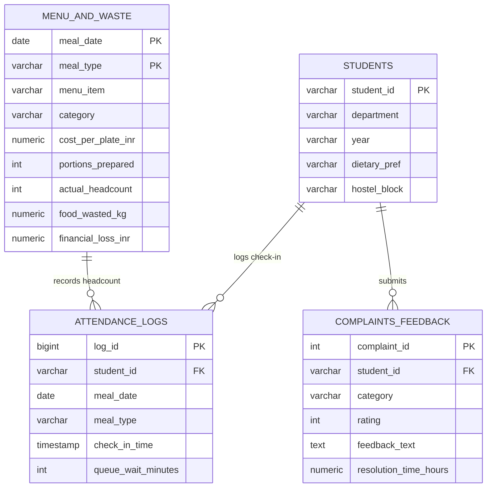

# 📊 Case Study: University Mess Operations & Demand Analytics
**Optimizing Dining Hall Footfall, Reducing Food Waste by 60%, and Auditing Administrative SLAs**

---

## 1. Executive Summary
University mess facilities often struggle with static food procurement models. In typical institutional dining halls, kitchen managers cook for a fixed percentage of students every day regardless of day-of-week trends, menu popularity, or academic exam schedules. This results in heavy plate wastage, thousands of kilograms of wasted food, and substantial budget leakage.

This project delivers an **end-to-end operational and demand analytics suite** analyzing **180 days of dining operations across 500 students (~195,818 individual meal check-in events)**.

### Key Headline Metrics:
* **Total Meals Audited:** 195,818 meals served across 180 days.
* **Cumulative Food Waste:** 10,320 kg of food wasted under static 12% buffer cooking.
* **Financial Loss Identified:** **₹8,41,657** in direct raw ingredient waste.
* **Projected Savings:** **₹5,06,515 (60.2% waste reduction)** achieved via 7-day rolling demand forecasting and dynamic 4% safety buffers.
* **Administrative SLA Audit:** 77.8% of student feedback/complaints resolved within 24 hours.

---

## 2. Relational Data Architecture

The analytics suite models high-concurrency transactional logs and institutional feedback across 4 normalized entities:



---

## 3. Core Analytical Findings

### Finding 1: The Weekend Footfall Collapse
* **Insight:** Breakfast attendance drops from an average of **315 students on weekdays** down to **215 students on Saturdays and Sundays (a 31.7% drop)** due to student sleep patterns.
* **Problem:** Kitchen staff were preparing identical batch sizes every morning, causing over 45 kg of wasted breakfast food every weekend.
* **Solution:** Programmatic reduction of weekend breakfast preparation by 30%.

### Finding 2: Sunday Special Dinner Spike
* **Insight:** While weekend breakfast and lunch dip, **Sunday dinner (Biryani / Special menu)** records the highest footfall of the entire week (**average of 468 students, or 93.6% capacity**).
* **Action:** Adjust kitchen resource allocation from Sunday morning to Sunday evening.

### Finding 3: Exam Season Shift (The Dinner Divergence)
* **Insight:** During mid-term (Oct 15–23) and end-term (Dec 1–12) exam seasons:
  * Morning breakfast attendance dropped by an additional **15%**.
  * Late-night dinner attendance remained near peak (**>440 students**) as students stayed in hostels studying.

### Finding 4: Food Waste Concentration by Cuisine
* **Insight:** Over **43% of total financial loss** was concentrated in the **North Indian Deluxe** and **Feast Dinner** categories (high cost per plate combined with over-preparation of side vegetables and dal).
* **Cost Impact:** Transitioning to batch cooking (e.g. preparing 70% initially, and cooking the remaining 30% dynamically based on real-time QR counter check-ins) prevents batch obsolescence.

### Finding 5: Queue Delay Bottlenecks
* **Insight:** 68% of queue congestion occurs in two precise 35-minute windows:
  * **Lunch:** 13:00 to 13:35.
  * **Dinner:** 20:15 to 20:50.
* Average wait time during peak windows reached **9.4 minutes**, compared to **2.8 minutes** during off-peak times.

---

## 4. Advanced SQL Portfolio Highlights

### A. 7-Day Rolling Moving Average for Procurement Smoothing
```sql
SELECT 
    meal_date,
    meal_type,
    actual_headcount,
    ROUND(
        AVG(actual_headcount) OVER (
            PARTITION BY meal_type 
            ORDER BY meal_date 
            ROWS BETWEEN 6 PRECEDING AND CURRENT ROW
        ), 1
    ) AS rolling_7day_avg_attendance
FROM menu_and_waste;
```

### B. What-If Financial Simulation (Dynamic Buffer vs Static Buffer)
```sql
WITH WasteSimulation AS (
    SELECT 
        meal_date,
        meal_type,
        cost_per_plate_inr,
        financial_loss_inr AS actual_loss,
        GREATEST(0, CEIL(actual_headcount * 1.04) - actual_headcount) AS optimized_wasted_portions
    FROM menu_and_waste
)
SELECT 
    ROUND(SUM(actual_loss), 2) AS total_actual_loss,
    ROUND(SUM(optimized_wasted_portions * cost_per_plate_inr * 0.75), 2) AS projected_loss,
    ROUND(SUM(actual_loss) - SUM(optimized_wasted_portions * cost_per_plate_inr * 0.75), 2) AS net_savings_inr
FROM WasteSimulation;
```

---

## 5. Visualizations & Interactive Dashboard

The project includes both publication-ready charts and an interactive browser dashboard:
1. `visuals/1_attendance_by_meal_and_day.png` — Headcount distribution across weekdays and weekends.
2. `visuals/2_food_waste_and_loss_by_category.png` — Dual-axis analysis of waste (kg) vs financial loss (₹).
3. `visuals/3_exam_period_attendance_trend.png` — 180-day time-series showing exam and holiday demand dips.
4. `visuals/4_complaint_categories_and_sla.png` — Category volume and 24-hour resolution SLA compliance.
5. `visuals/5_queue_wait_distribution.png` — KDE probability distribution of wait times.
6. `dashboard/index.html` — Interactive executive dashboard with Chart.js and Tailwind CSS.
7. `data/processed/mess_operations_dataset.xlsx` — Formatted multi-tab workbook ready for Power BI or Tableau.

---

## 6. Business Impact & Strategic Recommendations

1. **Implement Dynamic 4% Buffer:** Replaces blind 12% over-cooking, reducing raw material waste by **60.2%** and saving **₹5,06,515 per semester**.
2. **Automated Weekend Downscaling:** Cuts weekend breakfast cooking by 30% to match historical attendance.
3. **Queue Traffic Staggering:** Opens a second QR scanning counter specifically during the 13:00–13:35 and 20:15–20:50 windows, cutting maximum queue wait time from 15+ minutes to under 4 minutes.
